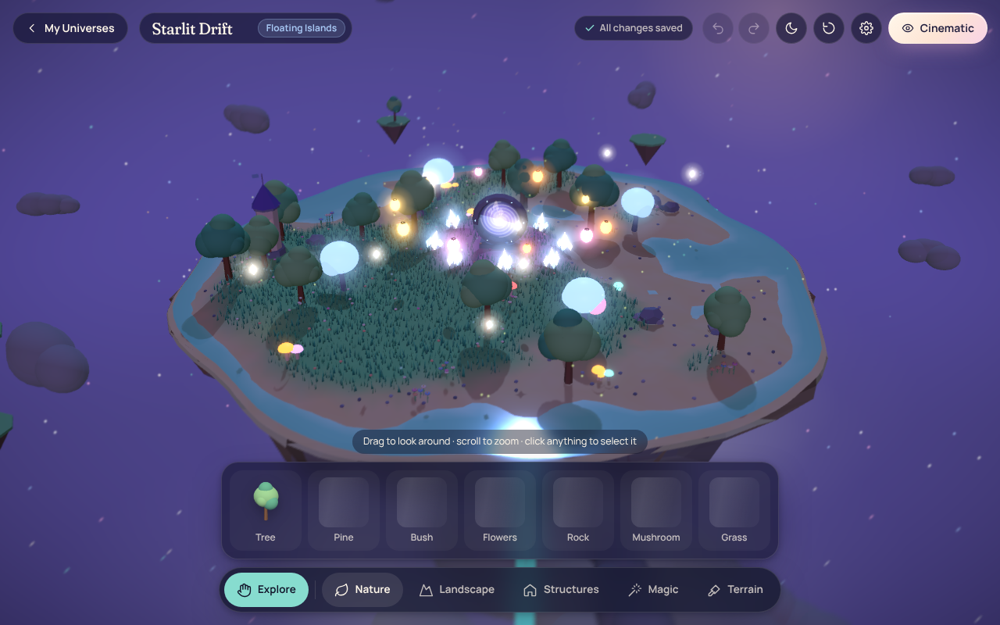

# Pocket Universe

*A whole world, made by you.* A cosy 3D world-builder that runs in the browser.


Create floating miniature worlds in six biomes, shape the land, place trees, houses and magic,
change the time of day and weather, and keep a whole collection of universes saved in your browser.




## Features

- Six biomes: Enchanted Forest, Floating Islands, Ocean Paradise, Dreamy Snowland, Celestial Desert, Candy Dream
- 22 hand-built, procedural low-poly objects (nature, landscape, structures, magic)
- Terrain sculpting (raise, lower, smooth) and ground painting with 8 surfaces
- Select, move, rotate, scale, duplicate and delete; undo/redo; keyboard shortcuts
- Morning, afternoon, sunset and night with smooth light transitions; rain and snow
- Living worlds: swaying grass and trees, drifting clouds, water, fireflies, butterflies, birds, lanterns
- My Universes collection with thumbnails: create, open, rename, duplicate, delete, export/import (JSON)
- Autosave to IndexedDB, cinematic view with screenshot capture, reduced-motion and lighter-graphics options

## Run it

```bash
npm install
npm run dev        # local development at http://localhost:5173
npm run build      # production build in dist/
npm run preview    # serve the production build
```

To publish, upload the `dist/` folder to any static host (Netlify: drag the folder onto app.netlify.com/drop).

## How it's built

- React 18 + TypeScript + Vite
- Three.js via React Three Fiber and Drei (OrbitControls)
- Zustand for state, Framer Motion for interface motion
- IndexedDB for saved worlds (localStorage fallback), small flags in localStorage
- All 3D assets are procedural low-poly models (no external model files)

```
src/data     world schema, biomes, object catalogue, seeded terrain generation, persistence
src/state    app/editor state: screens, history (undo/redo), autosave, discoveries
src/three    3D: island terrain, assets, atmosphere (sky, light, weather, life), editor input, camera
src/ui       screens: welcome, My Universes, create flow, builder HUD, settings, cinematic view
```

World schema (`src/data/types.ts`): id, name, biome, seed, size, environment (time, weather, sky tint,
ambient), terrain (heights, painted surfaces, coastline), placed objects (kind, position, rotation, scale,
variant), created/updated timestamps, schema version and a thumbnail.

## Shortcuts (builder)

Ctrl/⌘ Z undo · Ctrl/⌘ Shift Z or Ctrl Y redo · Delete remove · R rotate (Shift+R other way) ·
Ctrl/⌘ D duplicate · Ctrl/⌘ S save now · C cinematic view · Esc stop placing / deselect / leave cinematic
