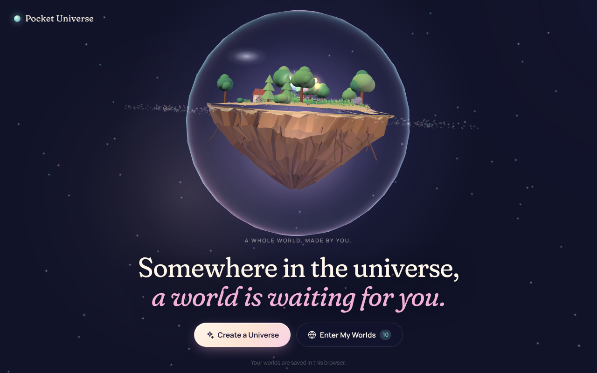
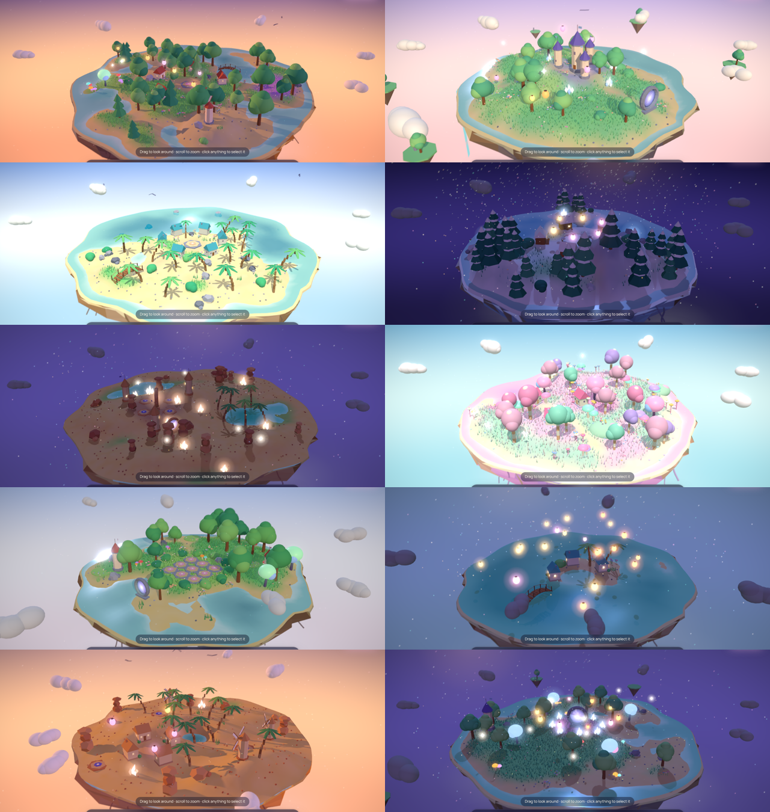

# Pocket Universe

*A whole world, made by you.* A cosy 3D world-builder that runs in the browser.



Create floating miniature worlds in six biomes, shape the land, place trees, houses and magic,
change the time of day and weather, and keep a whole collection of universes saved in your browser.




## Features

- Six biomes: Enchanted Forest, Floating Islands, Ocean Paradise, Dreamy Snowland, Celestial Desert, Candy Dream
- 34 hand-built, procedural low-poly objects (nature, landscape, structures, magic, friends): five kinds of home (cottage, round hut, manor, mushroom house, treehouse), fairy lights, fairies, glitter, a Babylon-style hanging garden, cute girls and boys, doggies and garden gnomes
- Terrain sculpting (raise, lower, smooth, dig rivers) and ground painting with 8 surfaces; an eraser brush
- Start with trees and houses or a flat, empty field (or clear any world from Settings)
- Resize anything from 30% to 300% (− / + buttons or keys), including before you place it
- A gentle generated lullaby (music button or M)
- Select, move, rotate, scale, duplicate and delete; undo/redo; keyboard shortcuts
- Morning, afternoon, sunset and night with smooth light transitions; rain and snow
- Living worlds: swaying grass and trees, drifting clouds, water, fireflies, butterflies, birds, lanterns
- My Universes collection with thumbnails: create, open, rename, duplicate, delete, export/import (JSON)
- Autosave to IndexedDB, cinematic view with screenshot capture, reduced-motion and lighter-graphics options

## Run it

```bash
npm install
npm run dev        # local development at http://localhost:5173
npm run build      # production build in dist/
npm run preview    # serve the production build
```

To publish, upload the `dist/` folder to any static host (Netlify: drag the folder onto app.netlify.com/drop).

## How it's built

- React 18 + TypeScript + Vite
- Three.js via React Three Fiber and Drei (OrbitControls)
- Zustand for state, Framer Motion for interface motion
- IndexedDB for saved worlds (localStorage fallback), small flags in localStorage
- All 3D assets are procedural low-poly models (no external model files)

```
src/data     world schema, biomes, object catalogue, seeded terrain generation, persistence
src/state    app/editor state: screens, history (undo/redo), autosave, discoveries
src/three    3D: island terrain, assets, atmosphere (sky, light, weather, life), editor input, camera
src/ui       screens: welcome, My Universes, create flow, builder HUD, settings, cinematic view
```

World schema (`src/data/types.ts`): id, name, biome, seed, size, environment (time, weather, sky tint,
ambient), terrain (heights, painted surfaces, coastline), placed objects (kind, position, rotation, scale,
variant), created/updated timestamps, schema version and a thumbnail.

## Shortcuts (builder)

Ctrl/⌘ Z undo · Ctrl/⌘ Shift Z or Ctrl Y redo · Delete remove · R rotate (Shift+R other way) ·
Ctrl/⌘ D duplicate · − / + smaller / bigger · M music · Ctrl/⌘ S save now · C cinematic view · Esc stop placing / deselect / leave cinematic

## Cloud save
Progress can follow the player to any device through one free Supabase project (shared with the other game,
so one account holds both). Without it, everything still saves in the browser as before.
1. Create a free project at https://supabase.com.
2. SQL Editor → New query → paste `cloud-setup.sql` → Run.
3. Project Settings → API: put the Project URL and the anon / publishable key in `public/cloud-config.js`
   (or in `cloud-config.js` next to `index.html` in a built copy). The anon key is safe to publish:
   row-level security lets each player read and write only their own saves.
4. Optional: Authentication → Sign In / Providers → Email → turn off "Confirm email" so new players can sign in at once.
Players sign in from **Cloud save** (title screen / Settings in The Impossible Path, the Cloud button on My Universes in
Pocket Universe). The newest copy of each world wins; finished levels from every device are combined.

### Mobile-number sign-in (optional)
Players can also sign in with a one-time code sent by SMS. It needs an SMS provider (Twilio, Vonage, MessageBird or
TextLocal — each text is billed by that provider):
1. Supabase → Authentication → Sign In / Providers → Phone → turn on, choose the provider and paste its keys.
2. In `cloud-config.js` set `phone: true` (and `country`, default "91", for numbers typed without a +code).
A mobile account and an email account are separate accounts — each player should stick to one.
